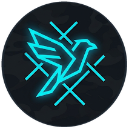

# DECOY v2 (웹판)



생존자 3명과 괴물 1명이 브라우저로 접속해 겨루는 온라인 비대칭 탈출 게임이다. 설치 없이 링크 하나로 4명이 들어온다.

- 생존자는 흩어져 거점 A · B를 점령하고, 두 명이 함께 탈출구를 열어 빠져나간다. 괴물에게는 모든 생존자가 **흰색**으로 보여서, 누가 누구인지 숨기며 미끼가 될 수 있다
- 괴물은 마우스로 시야와 공격 방향을 조준해 생존자를 쫓는다. 두 번 맞은 생존자는 감옥으로 간다
- 서버가 모든 판정을 하고, 플레이어마다 **볼 수 있는 것만** 보낸다(시야 밖 상대의 좌표는 아예 오지 않는다)

TypeScript · Phaser 3 · Node `ws` 권한 서버. 그래픽은 코드로 그린 단색 도형이고, 효과음은 WebAudio로 합성한다.

## 실행

Node 22 이상과 npm이 필요하다 (런타임은 Node 20 이상이면 되지만, 빌드 · 테스트 도구가 Node 22를 요구한다).

```bash
npm ci
npm run build
npm start            # http://localhost:8080
```

- **한 컴퓨터에서 시험**: 브라우저 탭 4개로 같은 방에 들어간다 (탭마다 다른 자리)
- **같은 와이파이**: `npm start` 한 컴퓨터의 IP로 `http://<IP>:8080/?room=방코드` (자세히: [docs/DEPLOY.md](docs/DEPLOY.md))
- **인터넷**: Render 무료 플랜(싱가포르, `render.yaml` — 태블릿 브라우저만으로 배포)을 쓰거나, Dockerfile로 한국 · 일본 리전 서비스에 배포한다 → [docs/DEPLOY.md](docs/DEPLOY.md). 무료 서버가 잠들어 있으면 깨어나는 동안 "서버를 깨우는 중…" 안내가 뜬다
- **개발 모드**: `npm run dev` (서버 + Vite 핫 리로드, http://localhost:5173)

### 주소 옵션

| 옵션 | 뜻 |
|---|---|
| `?room=ABCD` | 그 방으로 바로 들어간다 (로비의 "링크 복사") |
| `?bots=1` | 방을 만들 때 붙이면, 시작할 때 빈 역할을 순찰 봇이 채운다 (혼자 시험) |
| `?quality=low` | 그래픽 품질 낮음 (로비의 '그래픽'에서도 고를 수 있다. high · medium · low, 기본은 자동) |
| `?scale=0.5` | 렌더 해상도 배율 (0.25~1, 화면 크기 × 기기 픽셀 배율로 정한 해상도에 곱한다) |
| `?debug=1` | FPS · 핑 · 서버 틱 · 예측 오차 오버레이 |
| `?lag=200` | 인위적 지연 (왕복 ms, 시험용) |
| `?renderer=canvas` | Canvas 렌더러 강제 (기본은 WebGL) |

## 조작

| 입력 | 생존자 | 괴물 |
|---|---|---|
| WASD | 이동 (바라보는 방향 = 이동 방향) | 이동 |
| 마우스 | — | 시야 · 공격 방향 조준 |
| 좌클릭 | — | 공격 (0.4초 준비 뒤 타격) |
| 우클릭 | — | 시야 모드 전환 (탐색: 넓고 짧게 ↔ 추적: 좁고 길게) |
| E (누르고 있기) | 감옥 문 앞에서 구조 (3초) | — |
| Space | 고유 능력 | — |
| Shift | — | 돌진 |
| Q | — | 포효 |
| Tab (누르고 있기) | 점수판 · 상태 | 점수판 · 상태 |

## 규칙 요약

- **한 판 12분.** 생존자 셋은 중앙 감옥에서, 괴물은 맵 구석에서 시작한다. 괴물은 처음 5초 동안 움직일 수 없다
- **거점 A · B**: 자유 생존자가 안에 있으면 40초에 점령(2명 이상이면 1.5배). 괴물이 안에 있으면 멈춘다(5초 넘게 지키면 풀림). 점령하면 생존자에게 비밀 메모가 뜬다
- **탈출구 북 · 남**: 두 거점을 모두 점령하면 켜진다. 생존자 두 명이 한 탈출구에 함께 3초 서 있으면 문이 열리고, 열린 문으로 걸어 나가면 탈출
- **공격**: 두 번 맞으면 감옥으로. 수감 두 번 뒤 세 번째로 잡히면 사망. 동료가 감옥 문 앞에서 E를 3초 누르면 전원 풀려나고 4초 보호
- **능력**: 러너 질주(3초 ×1.45), 가드 밀치기(2타일 안 괴물 1.5초 기절), 스카우트 탐지(4초간 괴물 위치 공유). 능력을 쓰면 1초 동안 괴물에게 역할 색이 보인다. 괴물은 돌진(4타일)과 포효(반경 10 안 생존자 위치를 잠깐 보지만 자기 위치도 드러남)
- **승패**: 두 명 이상 탈출하면 생존자 승리(남은 사람은 최후의 30초). 두 명이 죽거나 세 명이 모두 갇히면 괴물 승리. 12분이 지나면 남은 생존자는 사망
- **접속이 끊기면** 30초 안에 같은 탭(새로고침)으로 돌아오면 그대로 이어진다. 괴물이 끊기면 판 전체가 멈추고, 30초 안에 안 돌아오면 판은 무효

모든 수치는 `config/balance.json`에 있고, 규칙의 원본은 [docs/GAME_DESIGN.md](docs/GAME_DESIGN.md)다.

## 테스트

```bash
npm run check          # 타입 · 린트 · 포맷
npm test               # 단위 + 봇 시나리오 (규칙 · 정보 차단 · 동기화)
npm run test:e2e       # 빌드 후 브라우저 4개 E2E 전체 (Playwright, 스크린샷은 artifacts/)
npm run test:e2e:core  # 핵심 E2E만 (@core 태그, PR CI가 돌리는 것)
npm run test:lag       # lag 100 · 200 실서버에 WebSocket 봇 4명으로 실시간 전체 판 (몇 분)
npm run verify:deploy  # Docker 이미지(없으면 빌드 결과물)를 띄워 HTTP · WebSocket 접속 확인
```

push · PR마다(그리고 main에 들어갈 때) GitHub Actions(`.github/workflows/ci.yml`)가 빠른 검사(`check` · `test` · `test:e2e:core`, 3분 안팎)를 돌린다. PR을 병합하기 직전에는 같은 워크플로를 그 브랜치에서 수동 실행(Actions 탭 → CI → Run workflow)해 전체 E2E(파일별 러너 시간으로 고르게 나눈 4개 작업, `scripts/e2e-shard.mjs`) · 지연 봇 판 · 배포 검증까지 돌리고, `전체 검사 결과`가 success여야 병합한다.

## 문서

| 문서 | 내용 |
|---|---|
| [docs/GAME_DESIGN.md](docs/GAME_DESIGN.md) | 규칙의 원본 |
| [docs/TECH_SPEC.md](docs/TECH_SPEC.md) | 구조 · 네트워크 · 정보 차단 · 테스트 |
| [docs/VISUAL_SPEC.md](docs/VISUAL_SPEC.md) | 색 · 형태 · 연출 · HUD |
| [docs/CREDITS.md](docs/CREDITS.md) | 외부 에셋(폰트 · 로고 · 이미지) 출처와 라이선스 |
| [docs/STORY_TEXT.md](docs/STORY_TEXT.md) | 게임 내 문구 |
| [docs/DEPLOY.md](docs/DEPLOY.md) | 로컬 · 같은 와이파이 · 인터넷 배포 (Render 무료 플랜 단계별 절차 포함) |
| [docs/PLAYTEST_GUIDE.md](docs/PLAYTEST_GUIDE.md) | 테스터용 플레이테스트 방법 |
| [docs/DECISIONS.md](docs/DECISIONS.md) | 설계와 다르게 만든 것 · 문서에 없어 정한 것 |
| [docs/HUMAN_CHECKS.md](docs/HUMAN_CHECKS.md) | 사람이 직접 확인할 것 |
| [docs/PROGRESS.md](docs/PROGRESS.md) | 마일스톤별 진행 기록 |

`docs/images/concept_*.png`는 생성형 AI로 만든 분위기 참고용 이미지로, 게임에서는 쓰지 않는다. 게임에 실리는 외부 파일은 로고(원본 `docs/images/logo_decoy.png`는 파비콘 · 작은 크기, 같은 디자인으로 다시 그린 SVG는 큰 화면)와 UI 폰트(Noto Sans KR 서브셋, SIL OFL 1.1)뿐이고, 출처 · 라이선스는 [docs/CREDITS.md](docs/CREDITS.md)에 적는다.

## 폴더

```
shared/   서버와 클라이언트가 같이 쓰는 코드 (이동 · 충돌 · 시야 · 맵 · 메시지 타입). Phaser 없음
server/   권한 서버 (방 · 틱 · 규칙 시스템 · 플레이어별 스냅샷 server/src/interest.ts · 봇)
client/   Phaser 클라이언트 (예측 · 보간 · 렌더링 · HUD · 효과음)
config/   balance.json (수치의 원본)
tests/    unit · bots · e2e · lag
```
