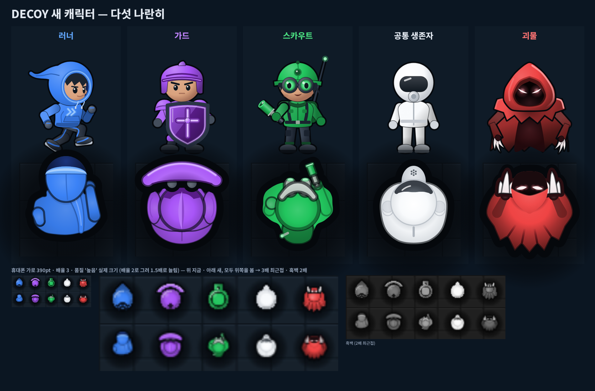
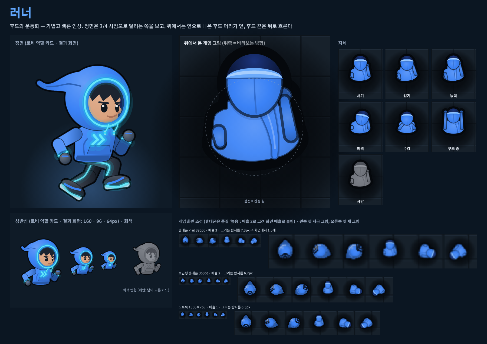
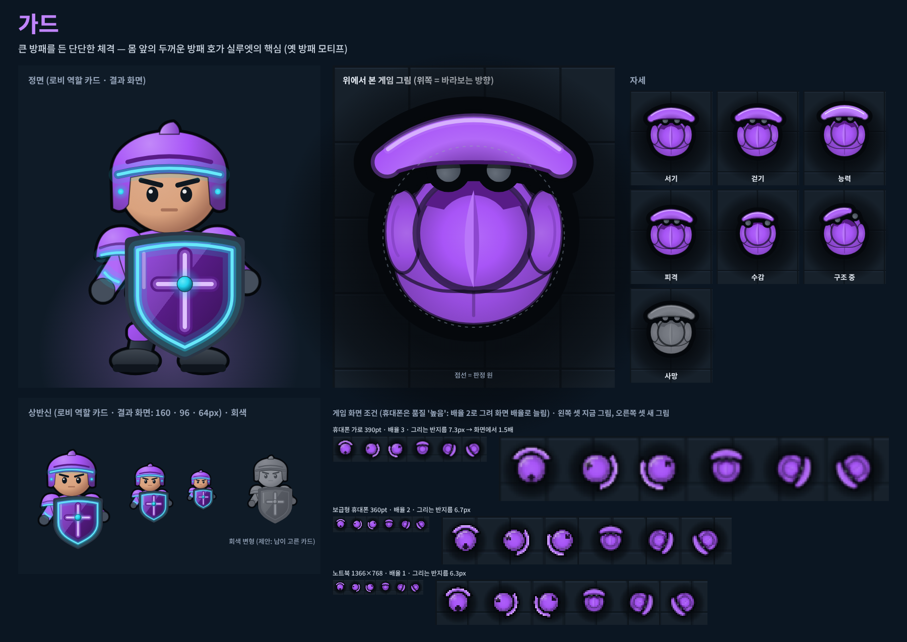
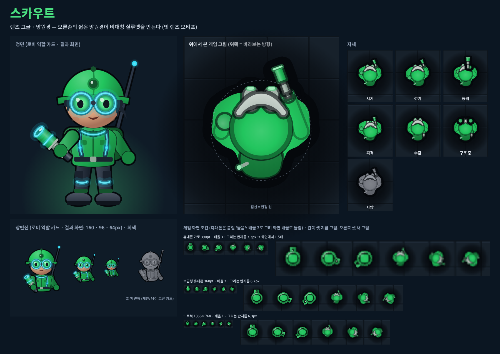
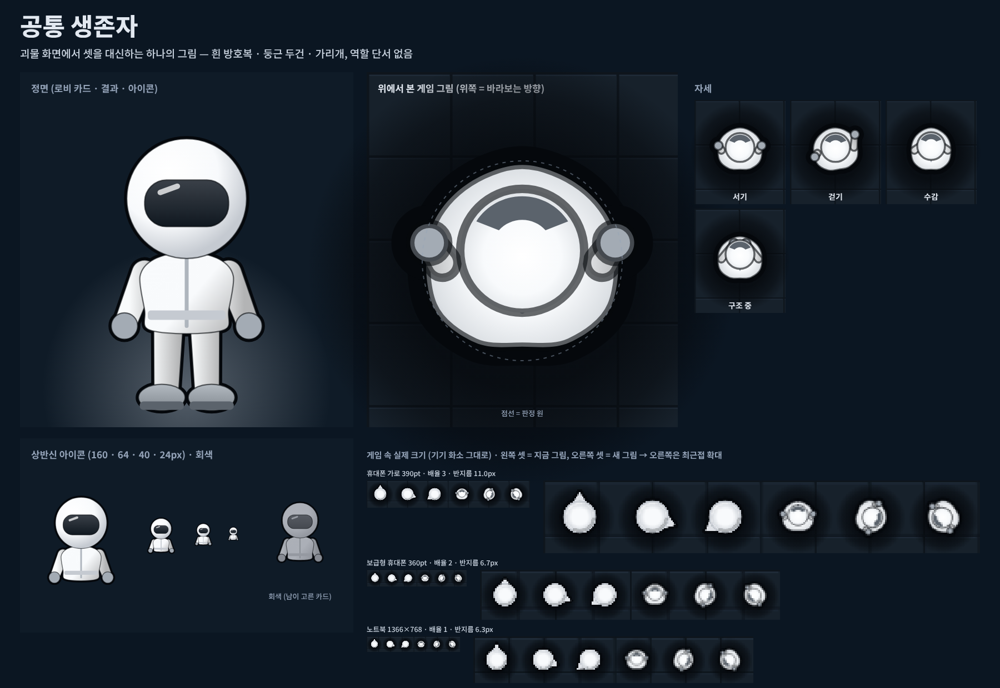
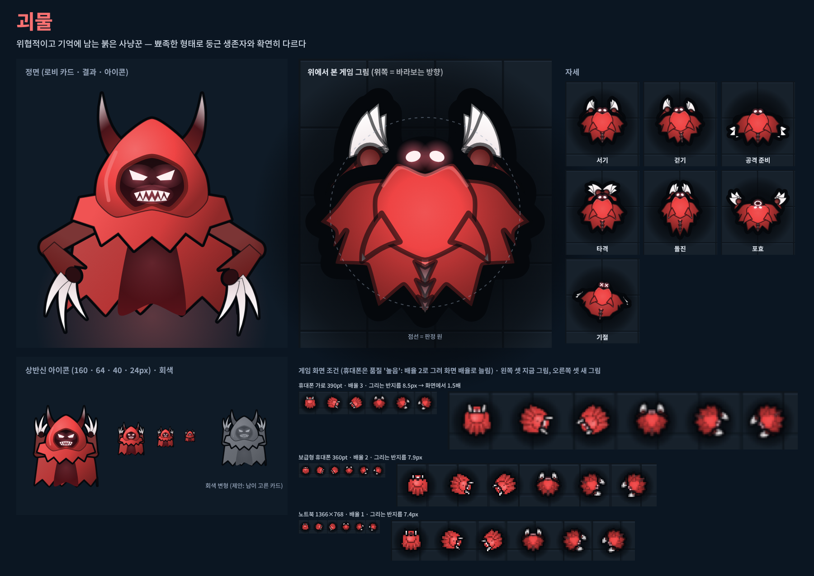
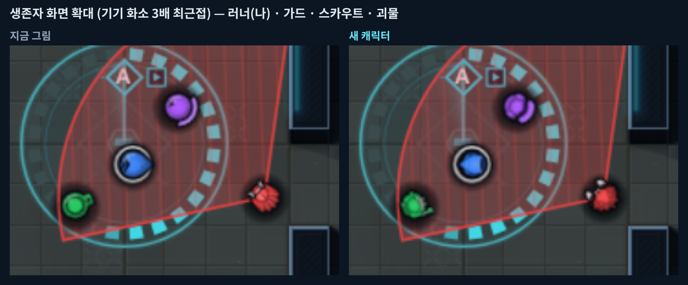
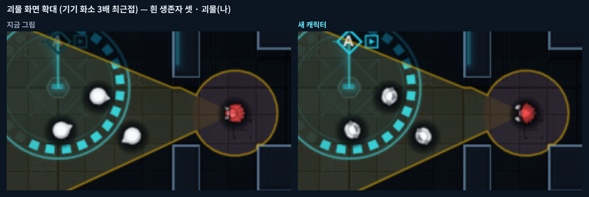
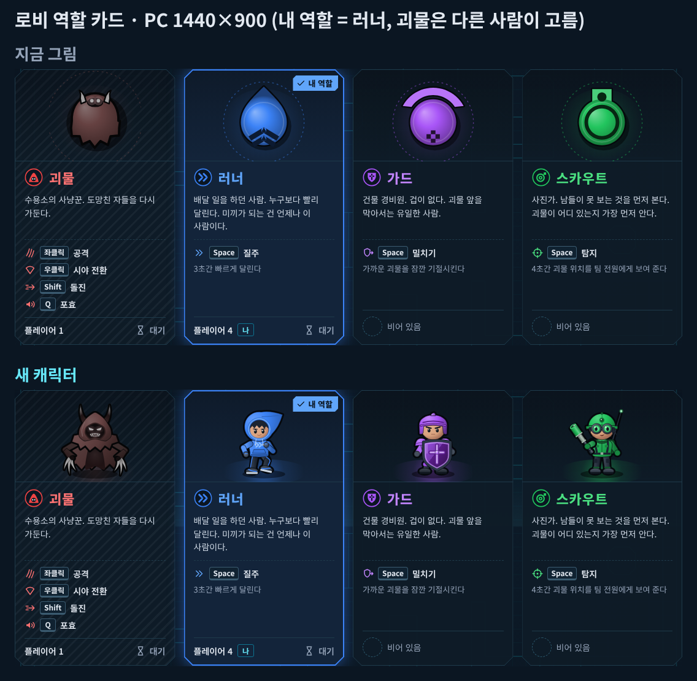
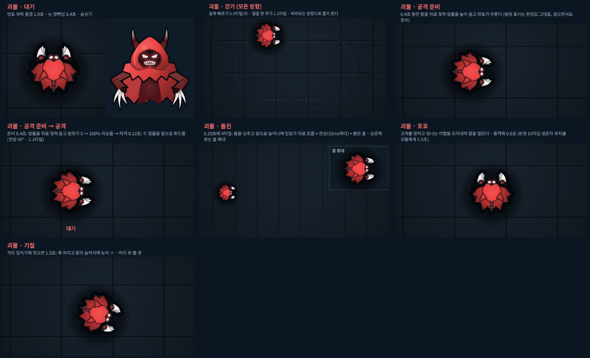

# DECOY 캐릭터 리디자인 — 시안과 2단계(게임에 넣기)

> **상태: 2단계 — 게임에 들어갔습니다(PR #21).** 설정 '캐릭터 스타일: 기존 / 새 캐릭터'(기본 기존)로 고릅니다. PC는 로비 첫 화면 그래픽 줄 아래, 휴대폰은 설정 판. 2차 시안에 주신 답 4가지(흑백 그대로 · 괴물 공격 방향 대등 · 러너 어깨 · 소매 가늘게 · 덩어리는 토글로 비교)와 정면 그림 청록 네온을 반영했습니다. 아래 1 · 2차 시안 기록은 그대로 둡니다. 게임 쪽 명세는 `docs/VISUAL_SPEC.md` 4.5, 결정과 이유는 `docs/DECISIONS.md` 8절.
>
> 정면 그림 청록 네온 전후: [front-neon.png](sheets/front-neon.png)

**먼저 볼 것 네 가지**

1. [다섯 캐릭터 나란히](sheets/lineup.png) — 정면 · 위에서 본 그림 · 휴대폰 실제 크기(지금 그림과 위아래로) · **흑백**
2. [작은 크기 판단 보드](sheets/small-size.png) — 다섯 캐릭터를 휴대폰 '높음' 조건으로 8방향, 지금 · 새를 위아래로, 오른쪽 2.5배 확대, 아래 **흑백** (결정 5 확인용)
3. 실제 게임 화면 비교 — [생존자 화면 확대](compare/ingame-survivor-zoom.png) · [괴물 화면 확대](compare/ingame-monster-zoom.png)
4. 캐릭터별 동작 모아 보기 GIF — [러너](anim/runner-all.gif) · [가드](anim/guard-all.gif) · [스카우트](anim/scout-all.gif) · [공통 생존자](anim/common-all.gif) · [괴물](anim/monster-all.gif)



## 2차 시안에서 바뀐 것 — 정해 주신 6가지

| 결정 | 이렇게 반영했습니다 |
|---|---|
| **1. 러너 방향 단서** — 3/4 시점에서는 얼굴 방향으로 앞뒤가 보이게, 후드 끝은 뒤로 흘러가게, 실루엣만 봐도 진행 방향이 헷갈리지 않게 | **정면(로비 카드 · 결과)**: 3/4 시점으로 바꿨습니다. 몸 · 얼굴이 화면 오른쪽(달리는 쪽)을 비스듬히 보고, 후드 끝은 왼쪽 뒤로 S자로 흐릅니다. **위 그림(게임)**: 옆으로 넓은 어깨 앞으로 둥근 후드 머리가 나와(앞 1.50r) **실루엣만으로 '머리 쪽 = 앞'**이 읽힙니다(지금 러너의 '앞 돌출'과 같은 언어). 후드 앞 끝에 이마 · 짙은 앞머리 · 네온 챙이 보여 색으로도 앞이 읽히고, 후드 끈은 등 위로 한쪽으로 휘어 흘러 실루엣을 뒤로 뾰족하게 만들지 않습니다(1차 시안의 '뒤를 가리키는 화살' 문제 해소) |
| **2. 괴물 인상** — 악마 같은 뿔 · 이빨은 줄이고 눈빛과 그림자로 위협감 | **정면**: 뿔 · 톱니 이빨을 없앴습니다(두건 꼭대기 작은 뾰족함 하나만). 거의 검은 깊은 두건 속에 가늘게 빛나는 V 실눈, 아래로 갈수록 짙어지는 망토, 두건 · 어깨의 붉은 림 라이트. 발톱은 작게. **위 그림**: 뒤 V 뿔 · 등뼈 돌기를 없애고, 지금 게임 괴물의 원칙대로 '앞은 매끈한 두건 · 어깨가 가장 넓고 뒤는 톱니 자락'. 앞 두건 속 짙은 얼굴 그늘 + 빛나는 실눈 + 짙은 손등에서 앞으로 뻗은 흰 발톱 |
| **3. 공통 생존자** — 방호복 인상 그대로, 방향 단서만 다른 생존자 수준으로 | 흰 방호복 · 둥근 두건 · 짙은 가리개는 그대로. 위 그림 앞에 짙은 가리개 + 앞으로 나온 둥근 방독면 필터 덮개를 둬 8방향 · 흑백 모두 앞이 읽힙니다(정면에도 같은 필터). 1회차의 네모난 필터 목('뚜껑 달린 병' 인상)은 없앴습니다 |
| **4. 크기 기준** — 기존 시각 명세를 지키고 발톱 · 팔 · 망원경을 줄여 맞춤 | **괴물**: 모든 자세(서기 · 걷기 · 공격 준비 · 타격 · 포효 · 기절)가 판정 반지름 **1.12배 안**, 돌진만 **1.35배 안**(VISUAL_SPEC 4.1). 발톱을 짧게 하고, 공격 준비 · 포효 · 기절의 팔을 몸 가까이 · 앞쪽으로 모았습니다. **생존자**: 앞 ±60° 안 1.55배(앞 돌출 한도), 옆 1.05배, 뒤 1.0배(지금 그림처럼 판정 원 안). 스카우트 망원경을 짧게 해 서기 · 걷기에서 가장 먼 점 1.39배(1차 1.57), 손 · 어깨 판 · 등 갑옷 · 배낭 · 러너 꼬리를 안으로. 모든 자세를 단위 테스트와 `node scripts/char-art.mjs sizes`가 확인합니다 |
| **5. 흑백 비교** — 2차 시안에서 다시 확인 | [다섯 나란히](sheets/lineup.png) 아래 흑백 줄과 [작은 크기 보드](sheets/small-size.png) 아래 흑백 칸을 봐 주세요. 실루엣 겹침(IoU)은 모든 쌍이 기준 안입니다(아래 표) |
| **6. 아이콘** — 작은 곳은 지금 문양 유지, 얼굴은 로비 역할 카드 · 결과 화면에만 | 정면 상반신 그림은 로비 역할 카드 · 결과 화면 크기(160 · 96 · 64px)로만 만들고 시트에도 그 크기만 놓았습니다. 괴물 화면 능력 노출 표시는 지금 문양 그대로입니다([공통 생존자 상태 GIF](anim/common-status.gif), [공통 생존자 시트](sheets/common.png) 맨 아래 실제 크기). 2단계 계획도 그렇게 고쳤습니다(아래) |

## 공통 원칙

| 원칙 | 어떻게 |
|---|---|
| **역할이 한눈에 보이는 캐릭터** | 도형 대신 2.6등신 치비 캐릭터. 셀 음영(색당 2~3단) + 굵은 어두운 외곽선 `#05080C` + 네온 포인트 — 로고의 '어두운 바탕 위 네온 선'과 같은 언어. 2단계에서 정면 그림 생존자 셋의 옷 · 장비에 **청록 네온 선 · 발광 점**(시설 네온과 같은 `#22D3EE` · `#0E7490` · `#67E8F9`)을 은은하게 넣었습니다. 게임 화면의 위 그림에는 넣지 않습니다(게임 화면에서 청록은 시설 · 목표) |
| **그림 두 벌** | 위에서 본 게임 그림(판정 원 기준, 바라보는 방향으로 회전)과 정면 그림(로비 역할 카드 · 결과 화면). 같은 옷 · 소품 · 색, 소품을 드는 손도 같습니다(스카우트 망원경 = 오른손) |
| **실루엣으로 역할 구분** | 휴대폰에서 생존자 몸 지름은 약 7 CSS px입니다(품질 '높음'은 반지름 약 7화소로 그려 화면 배율로 늘림). 색을 빼도 갈리게: 러너 = 넓은 어깨 + 앞으로 나온 후드 머리, 가드 = 몸 앞의 두꺼운 방패 호, 스카우트 = 고글 고리 + 한쪽 손의 짧은 망원경, 공통 생존자 = 흰 둥근 몸 + 짙은 가리개, 괴물 = 앞은 매끈한 두건 · 뒤는 톱니 자락 + 앞 흰 발톱 |
| **바라보는 방향이 실제 크기에서 읽히게** | 다섯 모두 앞쪽에 실루엣 · 밝기 단서: 러너 앞 머리 · 이마, 가드 방패, 스카우트 고글 · 망원경, 공통 생존자 가리개 · 필터, 괴물 얼굴 그늘 · 흰 발톱(공격 준비 · 타격 · 기절에서도 발톱은 몸 앞쪽) |
| **판정보다 커 보이지 않게** | 위 결정 4의 크기 기준 (수치는 아래 [규칙 측정](#규칙-측정)) |
| **색 규칙은 그대로** | 역할색 러너 `#3B82F6` · 가드 `#A855F7` · 스카우트 `#22C55E` · 괴물 `#EF4444`. 위 그림 몸 가운데는 역할색. 주황(경고) · 생존자 빨강(피해)은 쓰지 않고, 청록은 정면 그림 네온에만(위). 괴물 화면의 생존자는 흰색 `#F8FAFC`과 무채색뿐 |
| **괴물 화면 위장** | 세 생존자는 괴물 화면에서 '공통 생존자' 그림 하나로 그립니다. 공통 그림 함수는 걷기 · 수감 · 톤만 받는 전용 자세 타입이라(게임에서는 수감 자세도 쓰지 않습니다 — 기존 스타일과 같은 정보량, VISUAL_SPEC 0장 ③ · DECISIONS 8절) 역할 · 체력 · 능력 · 구조 값을 넣을 수 없습니다(타입 검사로 막음). 능력 노출 1초에만 역할색 테두리 + 머리 위 지금 문양 |
| **코드로 그림** | 모든 그림은 코드(`client/src/art/chars/`)가 그립니다. 같은 그림 명령에서 SVG(로비 · 결과 DOM)와 Canvas(게임 텍스처 아틀라스)를 만듭니다. 외부 에셋 없음 |

## 캐릭터

### 러너 — 후드와 운동화



- **콘셉트**: 가볍고 빠른 인상. 옛 물방울 모티프는 뒤로 흐르는 후드 끝으로 잇습니다
- **정면 (3/4 시점)**: 화면 오른쪽으로 달리는 자세. 얼굴 · 몸이 달리는 쪽을 보고, 끝이 S자로 휘는 후드 끝은 왼쪽 뒤로 흐릅니다. 먼 다리는 뒤로 차고 가까운 다리는 무릎을 들고, 팔치기. 가슴 » 무늬, 후드 끈이 뒤로 날림
- **위 그림**: 옆으로 넓은 어깨(팔 소매 포함) 앞으로 나온 둥근 후드 머리. 후드 앞 끝에 이마(살색) · 짙은 앞머리 · 네온 챙. 후드 끈은 등 위로 한쪽으로 휘어 흐르고 걸음에 출렁, 질주 때 곧게. 걸을 때 팔치기, 질주 때 머리를 더 내밀고 팔을 크게
- **동작**: [대기](anim/runner-idle.gif) · [걷기](anim/runner-walk.gif) · [질주](anim/runner-ability.gif) · [피격](anim/runner-hit.gif) · [수감](anim/runner-imprison.gif) · [구조](anim/runner-rescue.gif)

### 가드 — 큰 방패를 든 단단한 체격



- **콘셉트**: 옛 방패 모티프를 실제로 든 방패로
- **위 그림**: 몸 앞의 두꺼운 초승달 방패(보라 네온 테) — 어떤 자세든 방패가 앞이라 방향 단서. 볏 헬멧, 어깨 판, 몸 뒤를 감싸는 등 갑옷 판(판정 원 안으로 줄임)
- **정면**: 볏 헬멧, 굳은 눈매, 두 겹 어깨 갑옷, 몸통을 가리는 큰 방패 + 십자 문장
- **동작**: [대기](anim/guard-idle.gif) · [걷기](anim/guard-walk.gif) · [밀치기](anim/guard-ability.gif) · [피격](anim/guard-hit.gif) · [수감](anim/guard-imprison.gif) · [구조](anim/guard-rescue.gif)

### 스카우트 — 렌즈 고글 · 망원경



- **콘셉트**: 옛 렌즈 모티프를 고글과 망원경으로
- **위 그림**: 초록 머리 앞을 두른 고글 고리(초록 렌즈 빛 둘), 오른손에 쥔 짧은 망원경(1차보다 짧고 몸 가까이), 등 배낭과 왼쪽 어깨 뒤 안테나
- **정면**: 야전모, 큰 둥근 렌즈 고글(초록 네온), 오른손(화면 왼쪽)에 든 망원경, 왼쪽 어깨 뒤 안테나 — 위 그림과 같은 손 · 같은 쪽
- **동작**: [대기](anim/scout-idle.gif) · [걷기](anim/scout-walk.gif) · [탐지](anim/scout-ability.gif) · [피격](anim/scout-hit.gif) · [수감](anim/scout-imprison.gif) · [구조](anim/scout-rescue.gif)

### 공통 생존자 — 괴물 화면의 세 생존자



- **콘셉트**: 이름 없는 '미끼'. 흰 방호복 · 둥근 방호 두건 · 짙은 가리개 · 방독면 필터. 역할 단서가 하나도 없습니다
- **위 그림**: 부푼 흰 방호복 + 앞쪽 짙은 가리개 + 그 앞으로 나온 둥근 필터 덮개(숨구멍 무늬). 색은 `#F8FAFC`와 무채색 회색뿐
- **자세는 괴물이 받는 정보로만**: 서기 · 걷기 · 수감 · 사망(시안. 게임에서는 수감 자세를 쓰지 않고 쉬기 · 걷기만 — 기존 스타일과 같은 정보량, VISUAL_SPEC 0장 ③). 피격은 흰 번쩍만(불꽃 · 부상 표시 없음), 능력 · 구조 자세는 없습니다 — 서버가 괴물에게 체력 · 구조 중 여부 · 능력 상태를 보내지 않으므로(`interest.ts`) 그림도 그 정보를 흘릴 길이 없습니다
- **동작**: [대기](anim/common-idle.gif) · [세 명이 같은 그림 · 같은 걸음](anim/common-walk.gif) · [수감](anim/common-imprison.gif) · [보호 · 능력 노출](anim/common-status.gif)(노출 1초: 역할색 테두리 + 지금 문양)

### 괴물 — 두건 그림자 속 눈빛의 사냥꾼



- **콘셉트**: 옛 정체성(붉은 두건 · 톱니 자락 · 어둠 속 빛나는 눈 · 앞 발톱)을 잇고, 위협감은 뿔 · 이빨 대신 그림자와 눈빛으로
- **정면**: 깊은 붉은 두건(꼭대기 작은 뾰족함), 거의 검은 얼굴 공간 속 가늘게 빛나는 흰 분홍 V 실눈과 분홍 번짐, 아래로 짙어지는 너덜한 망토, 붉은 림 라이트, 작은 뼈 발톱
- **위 그림**: 앞은 매끈한 두건 · 넓은 어깨, 뒤는 톱니 자락 5갈래. 두건 앞 짙은 얼굴 그늘 속 실눈, 짙은 손등에서 앞으로 뻗은 흰 발톱(손마다 셋)
- **동작**: [대기](anim/monster-idle.gif) · [걷기](anim/monster-walk.gif) · [공격 준비](anim/monster-windup.gif)(몸을 비틀며 발톱을 앞 · 바깥으로 벌려 듦) · [공격](anim/monster-attack.gif)([4배 느리게](anim/monster-attack-slow.gif), 한 팔로 얼굴 앞을 가로질러 벰) · [돌진](anim/monster-dash.gif)([4배 느리게](anim/monster-dash-slow.gif)) · [포효](anim/monster-roar.gif)(고개를 젖히고 팔을 머리 양옆으로, 빛나는 목구멍) · [기절](anim/monster-stun.gif)(팔이 앞 · 안쪽으로 처지고 발톱이 흐려짐, 눈이 ×)

## 지금 디자인과 비교

실제 게임 빌드를 휴대폰 가로 800×360 · 기기 배율 3 · 품질 '높음'으로 띄워, **같은 순간 · 같은 자리**를 지금 그림으로 한 번, 캐릭터 아틀라스에 새 그림을 덮어 한 번 찍었습니다(`tests/char-art/compare.spec.ts`). 거점 · HUD 깜빡임은 두 장의 간격을 1초의 정수배로 맞춰 같은 위상에서 찍어, 두 장은 캐릭터 말고는 같습니다.

| 비교 | 그림 |
|---|---|
| 생존자 화면 (러너가 나, 거점 A, 괴물에게 발각) | [화면 전체](compare/ingame-survivor-view.png) · [확대](compare/ingame-survivor-zoom.png) |
| 괴물 화면 (추적 시야 안 흰 생존자 셋) | [화면 전체](compare/ingame-monster-view.png) · [확대](compare/ingame-monster-zoom.png) |
| 로비 역할 카드 | [PC 1440×900](compare/lobby-cards-pc.png) · [휴대폰 800×360](compare/lobby-cards-phone.png) |
| 봇과 연습 역할 고르기 | [휴대폰](compare/lobby-practice-phone.png) |
| 다섯 캐릭터 실제 크기로 걷기 (위 지금 · 아래 새) | [GIF (휴대폰 '높음' 조건, 기기 화소 2배 확대)](anim/actual-size-walk.gif) |
| 작은 크기 8방향 · 흑백 | [작은 크기 보드](sheets/small-size.png) |







- 휴대폰의 '높음' 품질은 기기 배율을 2로 묶어 그리므로, 캐릭터는 반지름 약 7화소로 그려진 뒤 화면 배율 3으로 1.5배 늘어나 보입니다. 시트 · 다섯 나란히 · 작은 크기 보드 · 실제 크기 GIF도 모두 이 조건으로 만들었습니다
- 게임 화면 비교는 **몸 그림만** 바꿨습니다. 서 있는 자세 그대로이고(새 그림의 걷기 · 동작 프레임은 2단계에서 굽습니다), 노출 표시 · 효과는 지금 그림입니다
- 다른 사람이 고른 괴물 카드가 갈색으로 보이는 것은 지금 로비의 흐림 필터를 그대로 받은 것이고, 2단계에서는 시트의 회색 변형 그림을 씁니다
- 연습 카드의 '스카우트' 글자 넘침 · 휴대폰 방 화면 아래 버튼 막대가 카드 끝 줄을 덮는 것은 **지금 로비의 배치 문제**로 지금 · 새 그림 모두 같습니다(이번 시안과 무관, 따로 고칠 거리)

## 애니메이션 GIF

모든 GIF는 [`anim/`](anim/)에 있습니다(동작 32개 25fps + 캐릭터별 모아 보기 5개 20fps). 시간은 규칙 값(`config/balance.json`)과 지금 연출 값(`client/src/art/anim.ts`)을 원본 파일에서 그대로 읽어 만듭니다. 효과(베기 호 · 불꽃 · 충격파 · 기절 별 · 거품 · 구조 링 · 속도선 · 부상 긁힘)는 게임 효과를 같은 색 · 시간 · 그리는 순서로 흉내 낸 것입니다.

| 캐릭터 | 대기 | 걷기(모든 방향) | 능력 | 피격 | 수감 | 구조 |
|---|---|---|---|---|---|---|
| 러너 | [idle](anim/runner-idle.gif) | [walk](anim/runner-walk.gif) | [질주](anim/runner-ability.gif) | [hit](anim/runner-hit.gif) | [imprison](anim/runner-imprison.gif) | [rescue](anim/runner-rescue.gif) |
| 가드 | [idle](anim/guard-idle.gif) | [walk](anim/guard-walk.gif) | [밀치기](anim/guard-ability.gif) | [hit](anim/guard-hit.gif) | [imprison](anim/guard-imprison.gif) | [rescue](anim/guard-rescue.gif) |
| 스카우트 | [idle](anim/scout-idle.gif) | [walk](anim/scout-walk.gif) | [탐지](anim/scout-ability.gif) | [hit](anim/scout-hit.gif) | [imprison](anim/scout-imprison.gif) | [rescue](anim/scout-rescue.gif) |
| 공통 생존자 (괴물 화면) | [idle](anim/common-idle.gif) | [walk](anim/common-walk.gif) | 없음 (괴물이 받지 않는 정보) | 흰 번쩍만 ([수감](anim/common-imprison.gif) 앞부분) | [imprison](anim/common-imprison.gif) | 없음 (보호는 [status](anim/common-status.gif)) |

| 괴물 | 대기 | 걷기 | 공격 준비 | 공격 | 돌진 | 포효 | 기절 |
|---|---|---|---|---|---|---|---|
| | [idle](anim/monster-idle.gif) | [walk](anim/monster-walk.gif) | [windup](anim/monster-windup.gif) | [attack](anim/monster-attack.gif) · [×¼ 속도](anim/monster-attack-slow.gif) | [dash](anim/monster-dash.gif) · [×¼ 속도](anim/monster-dash-slow.gif) | [roar](anim/monster-roar.gif) | [stun](anim/monster-stun.gif) |



## 규칙 측정

크기는 그림 경로를 직접 재고(`node scripts/char-art.mjs sizes`, 선 두께 제외, 단위 = 판정 반지름 r, 모든 자세), 나머지는 그림을 화소로 잽니다(`node scripts/char-art.mjs metrics`). 크기 기준 · 공통 생존자 무채색 · 자세 타입 등은 단위 테스트 `tests/unit/char-art.test.ts`가 늘 지킵니다.

| 항목 | 기준 | 결과 (2차 시안) |
|---|---|---|
| 생존자 앞 ±60° (모든 자세) | ≤ 1.55r | 러너 1.54(구조 중, 서기 1.50) · 가드 1.51(밀치기, 서기 1.44) · 스카우트 1.52(탐지, 서기 · 걷기 1.39) · 공통 1.26 |
| 생존자 옆 · 뒤 | 옆 ≤ 1.05r · 뒤 ≤ 1.0r | 옆 최대 1.03(스카우트) · 뒤 최대 1.00(공통) |
| 괴물 (모든 자세) | ≤ 1.12r, 돌진만 ≤ 1.35r | 서기 · 걷기 · 공격 준비 · 타격 · 포효 1.11 · 기절 1.05 / 돌진 1.25 |
| 몸 가운데(0.45r) 역할색 | 평균 ΔE ≤ 15, ΔE 15 이내 ≥ 85% | 러너 9.4 / 87.9% · 가드 5.1 / 89.3% · 스카우트 5.3 / 93.5% · 괴물 7.4 / 93.6% |
| 공통 생존자 몸 가운데 | 무채색 · 밝음 ≥ 90%, 역할색과 ΔE ≥ 40 | 100% · 최소 ΔE 66.3 |
| 실루엣 겹침 IoU (12.7 · 18 · 36px × 방향 0 · 0.6rad, 실루엣 전체 / 밝은 몸) | 역할끼리 ≤ 0.8, 공통과 ≤ 0.85 | 역할끼리 최대 0.788 / 0.727 (러너–가드) · 공통과 최대 0.831 / 0.789 (스카우트) |
| 덩어리: 판정 원을 밝은 몸이 덮는 비율 (반지름 6.7px = 휴대폰 '높음') | 사람 판단 | 러너 0.89 → 0.82 · 가드 0.93 → 0.89 · 스카우트 0.82 → 0.78 · 공통 1.00 → 0.91 · 괴물 0.76 → 0.76 (지금 → 새) |

## 확인해 주실 것 (2차)

1. **흑백 비교 (결정 5)** — [다섯 나란히](sheets/lineup.png) 아래 흑백 줄, [작은 크기 보드](sheets/small-size.png) 흑백 칸에서 다섯이 형태로 갈리는지. 러너 · 가드 · 스카우트는 밝기가 비슷해(지금 그림도 비슷) 형태로만 갈립니다
2. **괴물 위 그림의 방향 단서** — 크기 기준(1.12배) 안에서 휴대폰 크기 앞 단서(흰 발톱 둘 + 그 사이 짙은 얼굴 홈 속 눈 점)를 키웠지만, 지금 게임 괴물(네모난 몸 + 몸 밖으로 튀어나온 발톱)과 **대등한 수준**입니다. 발톱을 더 키우면 큰 그림에서 엄니처럼 보여 맞바꿈입니다. [괴물 화면 확대](compare/ingame-monster-zoom.png) · [작은 크기 보드](sheets/small-size.png)로 공격 방향이 충분히 읽히는지 봐 주세요
3. **러너 위 그림의 인상** — '넓은 어깨 + 앞 머리'로 방향은 실루엣만으로 읽히지만, 어깨 · 소매가 굵어 '가볍고 빠른' 인상은 정면 그림보다 약합니다
4. **덩어리** — 사람 모양이라 판정 원을 꽉 채운 지금 그림보다 조금 덜 채웁니다(공통 −9%, 러너 −7%). 휴대폰에서 작아 보이지 않는지 [생존자 화면 확대](compare/ingame-survivor-zoom.png)로 봐 주세요

## 2단계(게임에 넣기) — 계획 (2차 시안 때 적은 그대로, 실제 반영은 VISUAL_SPEC 4.5 · DECISIONS 8절)

- **설정**: "캐릭터 스타일: 기존 / 새 캐릭터"(기본 기존). PC는 로비 첫 화면의 그래픽 · 프레임 제한 옆, 휴대폰은 설정 판. 기기에 저장(저장 키 목록 · 처리방침 표에 추가)
- **스타일을 따르는 곳**: 게임 화면의 캐릭터(위 그림), 튜토리얼 화면 속 캐릭터, **로비 역할 카드 · 결과 화면의 캐릭터 얼굴(정면 상반신)**. HUD 팀 카드 · 점수판 · 플레이어 목록 · 조작 안내 아이콘 · 미니맵 · 괴물 화면 능력 노출 표시처럼 **작은 곳은 지금 문양 · 아이콘을 그대로** 씁니다(결정 6)
- **그리기 성능**: 고른 스타일의 그림만 텍스처 아틀라스 한 장으로 미리 굽습니다(로비 대기 중). 몸 · 신발 · 팔 · 소품을 자세별 프레임 하나에 구워 캐릭터 하나를 이미지 1~2장(그림자 + 몸)으로 찍습니다 — 지금(그림자 · 발 둘 · 몸 · 윤기)보다 그리기 수가 적고, 같은 텍스처라 WebGL 그리기 호출도 그대로입니다. 지금 화면에 맞는 해상도 단계만 GPU에 올립니다(텍스처 예산 32 / 8MiB). 일의 양 예산 게이트에 새 스타일 장면을 더해 120fps 목표 예산을 지킵니다
- **정보 차단**: 괴물 클라이언트에는 스타일과 무관하게 공통 생존자 그림 하나만 쓰고, 그리기 함수는 역할을 받지 않습니다(지금 구조 + 공통 생존자 전용 자세 타입). "괴물 화면에서는 어떤 스타일이든 세 생존자의 렌더링 결과가 같다"를 E2E 시험(push마다 도는 핵심 검사)으로 확인합니다
- **바꾸지 않는 것**: 게임 규칙 · 판정 · 서버 틱 · 스냅샷 · `config/balance.json`. `docs/VISUAL_SPEC.md`에 새 캐릭터 장을 더합니다(크기 기준은 지금 명세 그대로)
- PR로 올려 push마다 빠른 검사, 병합 직전 전체 E2E 샤딩 검사를 통과한 뒤 main에 병합합니다

## 파일과 다시 만드는 법

| 경로 | 내용 |
|---|---|
| [`sheets/`](sheets/) | 캐릭터별 큰 그림 시트 5장 + [다섯 나란히](sheets/lineup.png) + [작은 크기 보드](sheets/small-size.png) |
| [`compare/`](compare/) | 지금 디자인과 나란히 (실제 게임 · 로비) |
| [`anim/`](anim/) | 동작 GIF 32개 + 캐릭터별 모아 보기 5개 |
| `client/src/art/chars/` | 캐릭터 그림 코드 (`kit.ts` 그림 도구 · `survivorBase.ts` 공통 뼈대 · 정면 청록 네온 · `types.ts` 자세 타입 · `measure.ts` 크기 기준 · 캐릭터별 파일). 게임은 `client/src/art/charFrames.ts`(자세 프레임 이름 표 · 고르기)와 `art/atlas.ts`(새 스타일 굽기), 로비 · 결과는 `ui/uiArt.ts` frontFigureSvg로 씁니다 |
| `tests/unit/char-art.test.ts` | 그림 코드 단위 테스트 (크기 기준 · 범위 · 유한값 · 공통 생존자 무채색 · 자세 타입 · SVG id · 경로 수식) |
| `scripts/char-art.mjs` · `scripts/char-art/` | 미리보기 · 작은 크기 보드 · 크기 점검 · 측정 · 시트 · GIF 생성 (헤드리스 Chromium) |
| `tests/char-art/` | 실제 게임 비교 촬영 (Playwright). 점검 기록은 `tests/char-art/.results/`(커밋 안 함) |

```sh
node scripts/char-art.mjs sizes                 # 크기 기준 점검 (브라우저 없이, 넘으면 종료 코드 1)
node scripts/char-art.mjs preview runner        # 디자인 미리보기 보드 (artifacts/characters/_preview, 커밋 안 함)
node scripts/char-art.mjs small --out=artifacts/characters/sheets   # 작은 크기 판단 보드 (sheets/small-size.png)
node scripts/char-art.mjs metrics               # 규칙 측정
node scripts/char-art.mjs sheets                # sheets/
node scripts/char-art.mjs gifs                  # anim/ (ffmpeg 필요)
npm run build && npx playwright test --config tests/char-art/playwright.config.ts   # compare/
```
