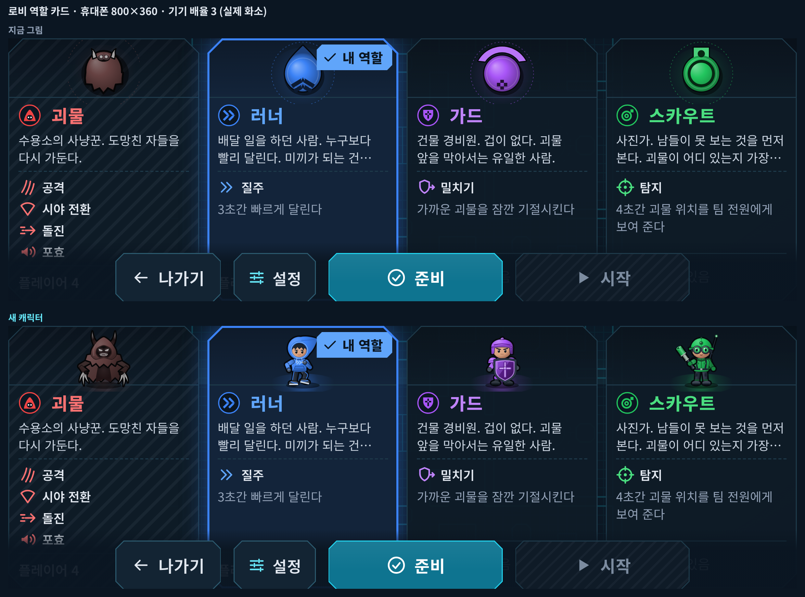

# DECOY 캐릭터 리디자인 — 1단계 시안

> **상태: 시안.** 게임에는 아직 들어가지 않았습니다(게임 코드 · 규칙 · 서버는 그대로). 그림을 보시고 "진행해" 또는 고칠 점을 알려 주시면 2단계(설정 "캐릭터 스타일: 기존 / 새 캐릭터"로 게임에 넣기)를 합니다.

**먼저 볼 것 세 가지**

1. [다섯 캐릭터 나란히](sheets/lineup.png) — 정면 · 위에서 본 그림 · 휴대폰 실제 크기(지금 그림과 위아래로) · 흑백
2. 실제 게임 화면 비교 — [생존자 화면 확대](compare/ingame-survivor-zoom.png) · [괴물 화면 확대](compare/ingame-monster-zoom.png)
3. 캐릭터별 동작 모아 보기 GIF — [러너](anim/runner-all.gif) · [가드](anim/guard-all.gif) · [스카우트](anim/scout-all.gif) · [공통 생존자](anim/common-all.gif) · [괴물](anim/monster-all.gif)


## 공통 원칙

| 원칙 | 어떻게 |
|---|---|
| **역할이 한눈에 보이는 캐릭터** | 도형 대신 2.6등신 치비 캐릭터. 셀 음영(색당 2~3단) + 굵은 어두운 외곽선 `#05080C` + 역할색 네온 포인트 1~3개 — 로고의 '어두운 바탕 위 네온 선'과 같은 언어 |
| **그림 두 벌** | 위에서 본 게임 그림(판정 원 기준, 바라보는 방향으로 회전)과 정면 그림(로비 카드 · 결과 · 아이콘). 같은 옷 · 소품 · 색, 소품을 드는 손도 같습니다(스카우트 망원경 = 오른손) |
| **실루엣으로 역할 구분** | 휴대폰에서 생존자 몸 지름은 약 7 CSS px입니다(품질 '높음'은 반지름 약 7화소로 그려 화면 배율로 늘림). 이 크기에서 색을 빼도 갈리게, 위 그림은 굵은 덩어리 2~4개로 역할을 말합니다: 러너 = 앞이 짙게 파인 둥근 후드 + 뒤로 흐르는 물방울 꼬리, 가드 = 몸 앞의 두꺼운 방패 호, 스카우트 = 고글 고리 + 한쪽 손의 망원경(비대칭), 괴물 = 사방이 뾰족한 망토 + 앞의 흰 발톱 |
| **바라보는 방향이 실제 크기에서 읽히게** | 다섯 모두 앞쪽에 짙은 · 밝은 대비나 튀어나온 부분이 있습니다: 러너 앞 얼굴 그늘, 가드 방패, 스카우트 망원경, 공통 생존자 짙은 가리개 + 앞으로 나온 방독면 필터, 괴물 흰 발톱 |
| **판정보다 커 보이지 않게, 작아 보이지도 않게** | 생존자 넷은 같은 뼈대(머리 · 어깨 · 손 · 신발 자리)를 쓰고 앞 돌출은 판정 반지름의 1.55배 이내, 옆은 1.12배 이내. 덩어리는 판정 원을 대부분 채웁니다 (수치는 아래 [규칙 측정](#규칙-측정-node-scriptschar-artmjs-metrics)) |
| **색 규칙은 그대로** | 역할색 러너 `#3B82F6` · 가드 `#A855F7` · 스카우트 `#22C55E` · 괴물 `#EF4444`. 위 그림 몸 가운데는 역할색(옛 그림과 같은 기준). 청록(시설) · 주황(경고) · 생존자 빨강(피해)은 쓰지 않습니다. 괴물 화면의 생존자는 흰색 `#F8FAFC`과 무채색뿐 |
| **괴물 화면 위장** | 세 생존자는 괴물 화면에서 '공통 생존자' 그림 하나로 그립니다. 공통 그림 함수는 걷기 · 수감 · 톤만 받는 전용 자세 타입이라 역할 · 체력 · 능력 · 구조 값을 넣을 수 없고(타입 검사로 막음), 서버가 괴물에게 보내지 않는 정보(누가 구조 중인지 등)로 바뀌는 자세도 없습니다. 능력 노출 1초에만 역할색 테두리 + 머리 위 역할 표시 |
| **코드로 그림** | 모든 그림은 코드(`client/src/art/chars/`)가 그립니다. 같은 그림 명령에서 SVG(로비 · 결과 DOM)와 Canvas(게임 텍스처 아틀라스)를 만듭니다. 외부 에셋 없음 |

## 캐릭터

### 러너 — 후드와 운동화


- **콘셉트**: 가볍고 빠른 인상. 옛 물방울 모티프를 "뒤로 흐르는 후드 끝(혜성 꼬리)"으로 이었습니다
- **위 그림**: 판정 원을 채우는 큰 물방울 후드(둥근 앞 + 뒤로 뾰족한 꼬리), 꼬리 위 » 하나, 앞쪽을 크게 파낸 짙은 얼굴 그늘 + 그 경계의 밝은 파랑 네온 테(후드 챙) — 실제 크기에서 '짙은 쪽이 앞'으로 방향을 보입니다. 파랑 장갑, 흰 밑창 운동화(걸을 때 앞뒤로)
- **정면**: 끝이 뒤 위로 휘날리는 물방울 후드, 후드 안 네온 테, 가슴 » 무늬, 캥거루 주머니, 큰 운동화(흰 밑창 · 파랑 포인트). 한 발을 든 까치발 · 팔치기 달리기 자세
- **동작**: [대기](anim/runner-idle.gif) · [걷기](anim/runner-walk.gif) · [질주](anim/runner-ability.gif)(머리가 앞으로, 팔을 뒤로 접고 보폭 ×1.35, 꼬리가 곧은 줄기로 길게, 네온이 밝게) · [피격](anim/runner-hit.gif) · [수감](anim/runner-imprison.gif) · [구조](anim/runner-rescue.gif)(후드 앞으로 두 손)

### 가드 — 큰 방패를 든 단단한 체격


- **콘셉트**: 옛 방패 모티프를 실제로 든 방패로
- **위 그림**: 몸 앞에 바짝 붙인 두꺼운 초승달 방패(보라 네온 테) — 어떤 자세든 방패가 앞이라 방향 단서가 됩니다. 볏 헬멧, 어깨 판 둘, 몸 뒤를 감싸는 큰 등 갑옷 판
- **정면**: 앞으로 기운 볏 헬멧, 굳은 눈매, 두 겹 어깨 갑옷, 보라 조끼, 무릎 보호대, 무거운 장화. 몸통의 65%를 가리는 큰 방패 + 십자 문장(보라 네온)
- **동작**: [대기](anim/guard-idle.gif) · [걷기](anim/guard-walk.gif) · [밀치기](anim/guard-ability.gif)(방패를 당겨 힘을 모았다가 앞으로 쭉, 테가 라일락으로 번쩍 → 괴물 기절) · [피격](anim/guard-hit.gif) · [수감](anim/guard-imprison.gif)(방패를 끌어안음) · [구조](anim/guard-rescue.gif)(방패를 왼쪽으로 비키고 오른손만 뻗기)

### 스카우트 — 렌즈 고글 · 망원경


- **콘셉트**: 옛 렌즈 모티프를 고글과 망원경으로
- **위 그림**: 초록 머리 앞을 두른 밝은 고글 고리(초록 렌즈 빛 둘), 오른손에 쥐고 앞을 겨눈 짧은 망원경(비대칭 실루엣), 등을 덮는 큰 배낭과 왼쪽 어깨 뒤 안테나
- **정면**: 챙이 처진 야전모, 큰 둥근 렌즈 고글(초록 네온), 재킷 · 멜빵, 오른손(화면 왼쪽)에 든 단을 나눈 망원경(유리 대물렌즈), 왼쪽 어깨 뒤 안테나 — 위 그림과 같은 손 · 같은 쪽
- **동작**: [대기](anim/scout-idle.gif) · [걷기](anim/scout-walk.gif) · [탐지](anim/scout-ability.gif)(망원경을 들어 눈에 대고 쭉 늘임 → 괴물 자리 초록 표시) · [피격](anim/scout-hit.gif) · [수감](anim/scout-imprison.gif)(망원경을 배낭 옆에 꽂음) · [구조](anim/scout-rescue.gif)(고글 양옆으로 두 손)

### 공통 생존자 — 괴물 화면의 세 생존자


- **콘셉트**: 이름 없는 '미끼'. 흰 방호복 · 둥근 방호 두건 · 짙은 가리개 · 방독면 필터. 역할 단서(후드 끝 · 방패 · 넓은 어깨 · 고글 · 망원경)가 하나도 없습니다
- **위 그림**: 부푼 흰 방호복(판정 원을 채움) + 앞쪽 짙은 가리개 초승달 + 가리개 앞으로 튀어나온 짧은 방독면 필터 통 — 괴물에게 바라보는 방향을 보여 줍니다(옛 그림의 앞 노치와 같은 정보, 모든 생존자에게 같은 부품이라 역할 단서가 아님). 색은 `#F8FAFC`와 무채색 회색뿐
- **정면**: 흰 방호복, 둥근 두건, 어두운 가리개(얼굴이 보이지 않음), 턱 앞 둥근 필터 — 괴물 HUD 익명 카드 · 점수판 아이콘
- **자세는 괴물이 받는 정보로만**: 서기 · 걷기 · 수감 · 사망뿐입니다. 피격은 흰 번쩍만(불꽃 · 부상 표시 · 젖힘 없음), 능력 · 구조 자세는 없습니다 — 서버가 괴물에게 체력 · 구조 중 여부 · 능력 상태를 보내지 않으므로(`interest.ts`), 그림이 그 정보를 흘릴 길을 처음부터 두지 않았습니다
- **동작**: [대기](anim/common-idle.gif) · [세 명이 같은 그림 · 같은 걸음](anim/common-walk.gif) · [수감](anim/common-imprison.gif) · [보호 · 능력 노출](anim/common-status.gif)(보호: 흰색 50% + 거품 깜빡임 / 노출 1초: 역할색 테두리 + 머리 위 역할 얼굴 — 지금은 문양)

### 괴물 — 위협적이고 기억에 남는 붉은 사냥꾼


- **콘셉트**: 옛 정체성(붉은 후드 · 톱니 자락 · 어둠 속 빛나는 눈 · 앞 발톱)을 뿔 두건 · 톱니 이빨 · 긴 팔의 뼈 발톱으로 키웠습니다. 둥근 생존자와 정반대인 뾰족한 형태
- **위 그림**: 앞의 흰 발톱 쐐기 둘(방향 단서), 어깨 가시, 두건이 뒤로 갈라진 붉은 V 뿔, 톱니 5개 자락, 등뼈 돌기, 빛나는 눈
- **정면**: 뿔 달린 붉은 두건, 어둠 속 흰 분홍 눈과 빛나는 톱니 이빨, 수그린 어깨, 밖으로 꺾인 팔과 긴 뼈 발톱, 아래로 좁아지는 너덜한 망토. 네온: 눈 빛 · 등뼈 틈 · 이빨 빛 · 망토 틈 불씨
- **동작**: [대기](anim/monster-idle.gif) · [걷기](anim/monster-walk.gif) · [공격 준비](anim/monster-windup.gif)(팔을 어깨 뒤로 젖혀 발톱을 높이, 범위가 0.4초에 차오름, 걸으면서도) · [공격](anim/monster-attack.gif)([4배 느리게](anim/monster-attack-slow.gif), 두 발톱을 앞에서 X자로) · [돌진](anim/monster-dash.gif)([4배 느리게](anim/monster-dash-slow.gif), 낮추고 늘어나며 자락이 뒤로 — 오른쪽 위에 몸 확대) · [포효](anim/monster-roar.gif)(팔을 넓게 벌리고 입이 열림) · [기절](anim/monster-stun.gif)(발톱이 뒤로 축 늘어지고 눈이 ×)

## 지금 디자인과 비교

실제 게임 빌드를 휴대폰 가로 800×360 · 기기 배율 3(2400×1080 화소) · 품질 '높음'으로 띄워, **같은 순간 · 같은 자리**를 지금 그림으로 한 번, 캐릭터 아틀라스에 새 그림을 덮어 한 번 찍었습니다(`tests/char-art/compare.spec.ts`). 장면 정지는 서버 → 화면 메시지를 잠깐 막아서 하고, 거점 · HUD 깜빡임(1초 주기)은 두 장의 간격을 1초의 정수배로 맞춰 같은 위상에서 찍습니다 — 두 장은 캐릭터 말고는 같습니다.

| 비교 | 그림 |
|---|---|
| 생존자 화면 (러너가 나, 거점 A, 괴물에게 발각) | [화면 전체](compare/ingame-survivor-view.png) · [확대](compare/ingame-survivor-zoom.png) |
| 괴물 화면 (추적 시야 안 흰 생존자 셋) | [화면 전체](compare/ingame-monster-view.png) · [확대](compare/ingame-monster-zoom.png) |
| 로비 역할 카드 | [PC 1440×900](compare/lobby-cards-pc.png) · [휴대폰 800×360](compare/lobby-cards-phone.png) |
| 봇과 연습 역할 고르기 | [휴대폰](compare/lobby-practice-phone.png) |
| 다섯 캐릭터 실제 크기로 걷기 (위 지금 · 아래 새) | [GIF (휴대폰 '높음' 조건, 기기 화소 2배 확대)](anim/actual-size-walk.gif) |
| 능력 노출 표시 실제 크기 (지금 문양 · 제안 얼굴) | [공통 생존자 시트 아래](sheets/common.png) |




- 휴대폰의 '높음' 품질은 기기 배율을 2로 묶어 그리므로, 캐릭터는 반지름 약 7화소로 그려진 뒤 화면 배율 3으로 1.5배 늘어나 보입니다. 시트 · 다섯 나란히 · 실제 크기 GIF의 '실제 크기' 그림도 모두 이 조건(작게 그려 부드럽게 늘림)으로 만들었습니다
- 게임 화면 비교는 **몸 그림만** 바꿨습니다. 서 있는 자세 그대로이고(새 그림의 걷기 · 동작 프레임은 2단계에서 굽습니다), 노출 배지 · 효과는 지금 그림입니다
- 로비 카드의 새 그림은 정면 캐릭터 + 발밑 무대 빛 시안입니다(2단계에서 다듬습니다). 다른 사람이 고른 괴물 카드가 갈색으로 보이는 것은 지금 로비의 흐림 필터를 그대로 받은 것이고, 2단계에서는 시트의 회색 변형 그림을 씁니다
- 비교 그림에 보이는 연습 카드의 '스카우트' 글자 넘침 · 휴대폰 방 화면 아래 버튼 막대가 카드 끝 줄을 덮는 것은 **지금 로비의 배치 문제**로, 지금 그림 · 새 그림 모두 같습니다(이번 시안과 무관, 따로 고칠 거리)

## 애니메이션 GIF

모든 GIF는 [`anim/`](anim/)에 있습니다(동작 32개 25fps + 캐릭터별 모아 보기 5개 20fps). 시간은 규칙 값(`config/balance.json`: 공격 준비 0.4초 · 타격 범위 1.2타일 · 돌진 0.25초에 4타일 · 기절 1.5초 · 구조 3초 · 보호 4초 · 능력 노출 1초 · 생존자 5타일/초 · 괴물 5.5타일/초 · 질주 ×1.45)과 지금 연출 값(`client/src/art/anim.ts`: 숨쉬기 2.6초 · 걸음 1.1타일 · 피격 번쩍 80ms · 찌그러짐 120ms · 흩어짐 · 나타남 0.3초 · 베기 120ms · 보호 깜빡임 150ms)을 원본 파일에서 그대로 읽어 만듭니다. 효과(베기 호 · 불꽃 · 충격파 · 기절 별 · 거품 · 구조 링 · 속도선 · 부상 긁힘)는 게임 효과를 같은 색 · 시간 · 그리는 순서로 흉내 낸 것입니다. 되풀이 장면(대기 · 걷기)은 끝에서 처음으로 이음매 없이 이어지고, 모아 보기는 모든 칸이 같이 시작해 짧은 칸은 마지막 자세로 기다립니다.

| 캐릭터 | 대기 | 걷기(모든 방향) | 능력 | 피격 | 수감 | 구조 |
|---|---|---|---|---|---|---|
| 러너 | [idle](anim/runner-idle.gif) | [walk](anim/runner-walk.gif) | [질주](anim/runner-ability.gif) | [hit](anim/runner-hit.gif) | [imprison](anim/runner-imprison.gif) | [rescue](anim/runner-rescue.gif) |
| 가드 | [idle](anim/guard-idle.gif) | [walk](anim/guard-walk.gif) | [밀치기](anim/guard-ability.gif) | [hit](anim/guard-hit.gif) | [imprison](anim/guard-imprison.gif) | [rescue](anim/guard-rescue.gif) |
| 스카우트 | [idle](anim/scout-idle.gif) | [walk](anim/scout-walk.gif) | [탐지](anim/scout-ability.gif) | [hit](anim/scout-hit.gif) | [imprison](anim/scout-imprison.gif) | [rescue](anim/scout-rescue.gif) |
| 공통 생존자 (괴물 화면) | [idle](anim/common-idle.gif) | [walk](anim/common-walk.gif) | 없음 (괴물이 받지 않는 정보) | 흰 번쩍만 ([수감](anim/common-imprison.gif) 앞부분) | [imprison](anim/common-imprison.gif) | 없음 (보호는 [status](anim/common-status.gif)) |

| 괴물 | 대기 | 걷기 | 공격 준비 | 공격 | 돌진 | 포효 | 기절 |
|---|---|---|---|---|---|---|---|
| | [idle](anim/monster-idle.gif) | [walk](anim/monster-walk.gif) | [windup](anim/monster-windup.gif) | [attack](anim/monster-attack.gif) · [×¼ 속도](anim/monster-attack-slow.gif) | [dash](anim/monster-dash.gif) · [×¼ 속도](anim/monster-dash-slow.gif) | [roar](anim/monster-roar.gif) | [stun](anim/monster-stun.gif) |


## 규칙 측정 (`node scripts/char-art.mjs metrics`)

그림을 반지름 100px로 그려 화소로 잽니다(외곽선 두께 뺌, 단위 = 판정 반지름 r). 같은 약속(경로가 굽기 프레임 안에 드는지, 공통 생존자가 무채색뿐인지, 자세 타입 등)은 단위 테스트 `tests/unit/char-art.test.ts`가 늘 지킵니다.

| 항목 | 기준 | 결과 (새 그림) |
|---|---|---|
| 생존자 앞 돌출 (모든 자세) | ≤ 1.55r | 러너 1.42(구조 중) · 가드 1.47(밀치기 절정) · 스카우트 1.51(탐지 절정) · 공통 1.26(필터) |
| 생존자 옆 · 뒤 | 옆 ≤ 1.12r | 옆: 러너 0.91 · 가드 1.10 · 스카우트 1.10 · 공통 1.09 / 뒤: 러너 1.10(꼬리) · 가드 1.07 · 스카우트 1.10 · 공통 0.90 |
| 괴물 범위 (앞 · 옆) | 서기 · 걷기 ≤ 1.2, 준비 · 타격 ≤ 1.45(걸으며 준비 포함), 돌진 ≤ 1.4 | 앞 1.14 · 1.20 / 준비 옆 1.43, 걸으며 준비 1.45 / 타격 앞 1.33 / 돌진 앞 1.37 |
| 가장 먼 점 (방향 무관, 참고) | 기준 없음 — 아래 '결정해 주실 것' 4 | 러너 1.46 · 가드 1.47 · 스카우트 1.57(망원경 끝, 걸을 때) · 공통 1.26 · 괴물 서기 1.25 · 걷기 1.36 · 포효 1.62 (지금 그림 서기: 생존자 1.50~1.55 · 괴물 1.15) |
| 몸 가운데(0.45r) 역할색 | 평균 ΔE ≤ 15, ΔE 15 이내 ≥ 85% | 러너 7.6 / 96.2% · 가드 5.1 / 89.3% · 스카우트 4.9 / 94.3% · 괴물 6.8 / 89.5% |
| 공통 생존자 몸 가운데 | 무채색 · 밝음 ≥ 90%, 역할색과 ΔE ≥ 40 | 92.5% · 최소 ΔE 63.7 |
| 실루엣 겹침 IoU (12.7 · 18 · 36px × 방향 0 · 0.6rad, 옛 `shapes.test.ts`와 같은 조건) | 역할끼리 ≤ 0.8, 공통과 ≤ 0.85 | 실루엣 전체: 역할끼리 최대 0.795(가드–스카우트) · 공통과 최대 0.845(러너) / 밝은 몸만: 0.737 · 0.829 |
| 덩어리: 판정 원을 밝은 몸이 덮는 비율 (반지름 6.7px = 휴대폰 '높음') | **사람 판단** (숫자 기준 없음) | 러너 0.89 → 0.82 · 가드 0.93 → 0.88 · 스카우트 0.82 → 0.83 · 공통 1.00 → 0.89 · 괴물 0.76 → 0.74 (지금 → 새) |

- 덩어리: 사람 모양(머리 + 어깨)이라 판정 원을 꽉 채운 옛 원보다는 조금 덜 채웁니다(남는 것은 대부분 가장자리 외곽선 고리). 휴대폰에서 작아 보이는지는 [생존자 화면 확대](compare/ingame-survivor-zoom.png)로 판단해 주세요

## 확인 · 결정해 주실 것

1. **러너 물방울 방향** — 지금 러너는 '앞이 뾰족한 화살'이고, 새 러너는 '둥근 앞 + 뒤로 뾰족한 꼬리(혜성)'입니다. 실제 크기에서는 꼬리 끝이 가장 눈에 띄어, 지금 그림에 익숙하면 **반대쪽을 본다고 읽을 수 있습니다** — [생존자 화면 확대](compare/ingame-survivor-zoom.png) 가운데 러너(오른쪽을 봄)를 봐 주세요. 앞쪽을 짙은 얼굴 그늘로 크게 파내 '짙은 쪽이 앞'이라는 단서를 넣었습니다. 이대로 갈지, 아니면 후드 끝을 짧게 세워 꼬리를 실루엣에서 빼고 얼굴 그늘만으로 방향을 보일지 골라 주세요
2. **괴물의 뿔 · 이빨** — '악마 같은' 인상이 게임 분위기(어두운 시설의 붉은 사냥꾼)에 맞는지
3. **공통 생존자** — 흰 방호복 · 두건 · 방독면(우주인 같은 인상)이 괜찮은지. 바라보는 방향은 짙은 가리개 + 앞으로 나온 필터 통으로 보입니다([괴물 화면 확대](compare/ingame-monster-zoom.png)) — 지금 그림의 앞 뾰족 끝보다는 약합니다
4. **크기 기준** — 새 괴물은 서 있을 때 발톱 끝까지 1.25r로 지금 괴물(1.15r)보다 조금 크고, 지금 시각 명세(VISUAL_SPEC 4.1 '망토 자락 1.12r 이내, 돌진 때만 1.35r')를 넘습니다(포효 때 벌린 팔 1.62r). 스카우트 망원경 끝은 대각선으로 1.57r입니다(앞 돌출 1.55r 기준은 앞쪽만 잼). 새 그림 기준으로 명세를 고칠지(2단계에서 VISUAL_SPEC에 적음), 발톱 · 팔 · 망원경을 줄일지 골라 주세요
5. **휴대폰 실제 크기** — [다섯 나란히](sheets/lineup.png) 아래 흑백 줄에서 넷이 실루엣만으로 갈리는지
6. **아이콘 쓰는 곳 (2단계 제안)** — 새 스타일에서는 로비 카드 · 결과 화면 · 플레이어 목록 · 점수판 · 조작 안내 · 팀 카드에 **정면 상반신 아이콘**을, 미니맵에는 **위 그림 축소판**을 쓰려 합니다(괴물 화면 익명 카드 · 점수판은 공통 생존자 아이콘만). 괴물 화면 능력 노출 배지를 지금 문양 대신 역할 **얼굴 아이콘**으로 바꿀지는 [공통 생존자 시트](sheets/common.png) 맨 아래 실제 크기 비교로 판단해 주세요(작은 크기에서는 지금 문양이 더 또렷합니다)

## 2단계(게임에 넣기) 계획 — "진행해" 뒤에 할 일

- **설정**: "캐릭터 스타일: 기존 / 새 캐릭터"(기본 기존). PC는 로비 첫 화면의 그래픽 · 프레임 제한 옆, 휴대폰은 설정 판. 기기에 저장(저장 키 목록 · 처리방침 표에 추가). 로비 역할 카드 · 봇과 연습 · 결과 화면 · 조작 안내(튜토리얼) · HUD 팀 카드 · 점수판 · 미니맵이 고른 스타일을 따릅니다
- **그리기 성능**: 고른 스타일의 그림만 텍스처 아틀라스 한 장으로 미리 굽습니다(로비 대기 중). 몸 · 신발 · 팔 · 소품을 자세별 프레임 하나에 구워 캐릭터 하나를 이미지 1~2장(그림자 + 몸)으로 찍습니다 — 지금(그림자 · 발 둘 · 몸 · 윤기)보다 그리기 수가 적고, 같은 텍스처라 WebGL 그리기 호출도 그대로입니다. 해상도 단계 몇 개를 정해 두고 지금 화면에 맞는 단계만 GPU에 올립니다(텍스처 예산 32 / 8MiB). 일의 양 예산 게이트(기준 × 1.05)에 새 스타일 장면을 더해 120fps 목표 예산을 지킵니다
- **정보 차단**: 괴물 클라이언트에는 스타일과 무관하게 공통 생존자 그림 하나만 쓰고, 그리기 함수는 역할을 받지 않습니다(지금 구조 + 이번에 만든 공통 생존자 전용 자세 타입). "괴물 화면에서는 어떤 스타일이든 세 생존자의 렌더링 결과가 같다"를 E2E 시험(push마다 도는 핵심 검사)으로 확인합니다
- **바꾸지 않는 것**: 게임 규칙 · 판정 · 서버 틱 · 스냅샷 · `config/balance.json`. `docs/VISUAL_SPEC.md`에 새 캐릭터 장을 더합니다
- PR로 올려 push마다 빠른 검사, 병합 직전 전체 E2E 샤딩 검사를 통과한 뒤 main에 병합합니다

## 파일과 다시 만드는 법

| 경로 | 내용 |
|---|---|
| [`sheets/`](sheets/) | 캐릭터별 큰 그림 시트 5장 + [다섯 나란히](sheets/lineup.png) |
| [`compare/`](compare/) | 지금 디자인과 나란히 (실제 게임 · 로비) |
| [`anim/`](anim/) | 동작 GIF 32개 + 캐릭터별 모아 보기 5개 |
| `client/src/art/chars/` | 캐릭터 그림 코드 (`kit.ts` 그림 도구 · `survivorBase.ts` 공통 뼈대 · `types.ts` 자세 타입 · 캐릭터별 파일). 아직 게임이 불러 쓰지 않습니다 |
| `tests/unit/char-art.test.ts` | 그림 코드 단위 테스트 (범위 · 유한값 · 공통 생존자 무채색 · 자세 타입 · SVG id · 경로 수식) |
| `scripts/char-art.mjs` · `scripts/char-art/` | 미리보기 · 작은 크기 보드 · 측정 · 시트 · GIF 생성 (헤드리스 Chromium) |
| `tests/char-art/` | 실제 게임 비교 촬영 (Playwright). 점검 기록은 `tests/char-art/.results/`(커밋 안 함) |

```sh
node scripts/char-art.mjs preview runner        # 디자인 미리보기 보드 (artifacts/characters/_preview, 커밋 안 함)
node scripts/char-art.mjs small                 # 작은 크기 판단 보드 (휴대폰 '높음' 조건 8방향, 지금 · 새)
node scripts/char-art.mjs metrics               # 규칙 측정
node scripts/char-art.mjs sheets                # sheets/
node scripts/char-art.mjs gifs                  # anim/ (ffmpeg 필요)
npm run build && npx playwright test --config tests/char-art/playwright.config.ts   # compare/
```
